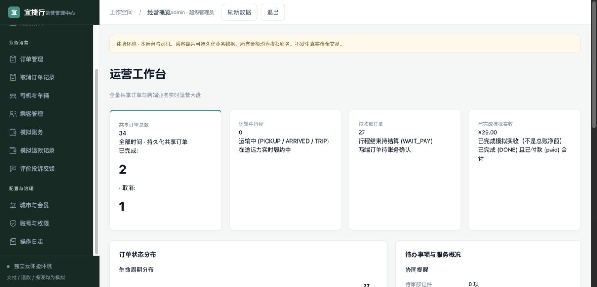
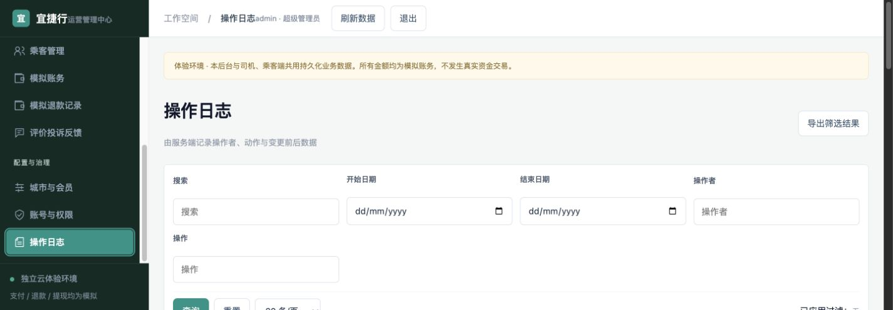
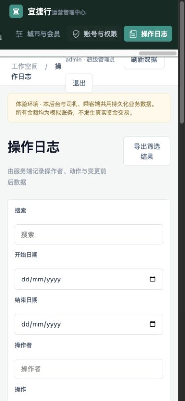

# ADMIN05 侧栏限定独立验收

**PASS_SCOPE**：固定产品 `7f489c243cb7d93ef6718cee13357ba330083e07` 的侧栏修复，通过本地合成真实页面浏览器检查；不是线上发布结论。实际服务CSS与固定提交和工作树字节完全相同。

1. **1440×693，正常**：侧栏与底部提示矩形相接无覆盖，滚动后底部3按钮中心命中自身；12菜单40px。
2. **底部3菜单，正常**：实际打开城市会员、账号权限、日志，标题和表格对应。未更改配置。
3. **1440×500，正常**：Tab可访问12菜单，40px不压缩，焦点可见且自动滚动，Enter打开日志。
4. **1440×900，正常**：12菜单完整可见，无遮挡。
5. **390×844，导航正常**：横向滚到末尾，3按钮命中/点击均正常；窄屏既有34px导航保留。页头仍拥挤，不把限定导航PASS扩大为整页移动布局通过。

视口已reset，本地账号退出、独立QA页关闭；用户在线投诉标签未操作；Chrome交回协调者。没有源码修改、ADB、部署或业务配置提交。旧CSS重现、云发布回读、全量功能与完整无障碍NOT_RUN。

报告SHA256 `ceaaf6b7ffe9b625a71b79e6cf234fc3549893d99668bec1bc700d74a784d45c`；详细矩形、焦点、内容、命令和证据摘要见design-qa.json。切尺寸后第一张窄图08因旧画面被拒绝；以下稳定截图为已查看证据。

