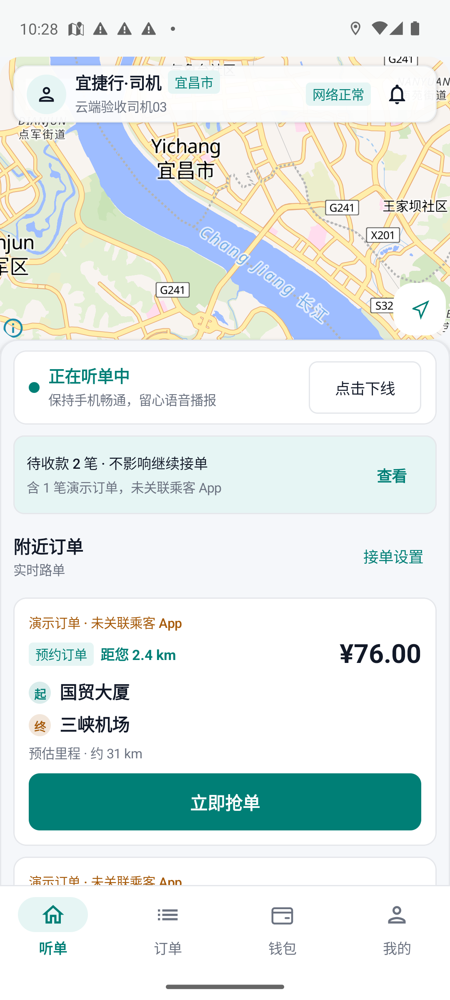
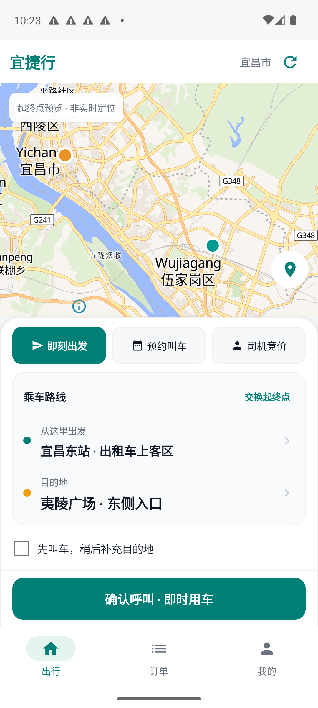

# NET-20261025-01 原生App升级独立验收

结论 **PASS_SCOPE**，仅限两款App由旧包升级至稳定API域名的差量。产品源码 `7ee63cc33d8f08808d24ee1c27477415933a72ab`，实际装机包、签名与版本一致。合并SHA和公开发布回读由coordinator统一补齐。

| 项目 | 结果 |
|---|---|
| 司机0.3.11-cloud / code14 | 原司机03保留，首页/地图/网络正常，资料15接单/10完单/¥557.74，冷启动保留登录 |
| 乘客1.1.11-experience / code13 | 原乘客02（0102）保留，前后资料一致，刷新订单及冷启动地图正常 |
| 实际安装包 | 两设备base.apk SHA256、签名、版本及DEX中的HTTPS origin全部核对 |
| 主机健康检查 | 自有域名health HTTP200且TLS验证通过；不是模拟器抓包 |
| 设备收尾 | 最后检查2026-10-25T22:28:10.865204+08:00，App停止并回桌面；网络/尺寸/密度/字号前后相同，未清数据或重启AVD |

早期UiAutomator无法取得旧司机页面树，后使用精确组件am start -W及20秒等待的活动截图确认；初始失败记录保留。最终图片已人工查看。乘客首次升级图顶部系统通知遮挡，以再次打开的干净截图为准。

本轮未重跑全量功能、完整三端订单/金额链路、高德、真机或无障碍矩阵；未验收后台DNS/证书与公开安装包发布。司机紧邻升级前资料页未取得，不声称其前后资料逐字段对比。

完整机器报告：design-qa.json，SHA256 `cc422bbe9bea3ebc2aa7da2b15abd53ed239853a0293ee2e4e70a1376bb9e5b6`。原始命令/页面树/截图及文件摘要在报告清单内。

