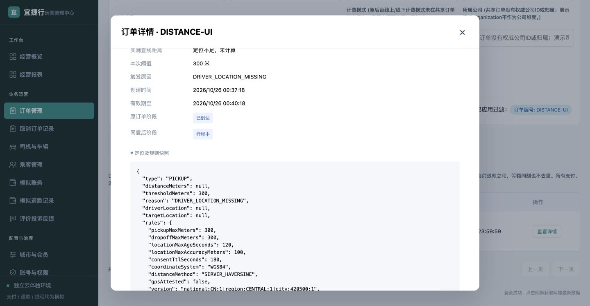
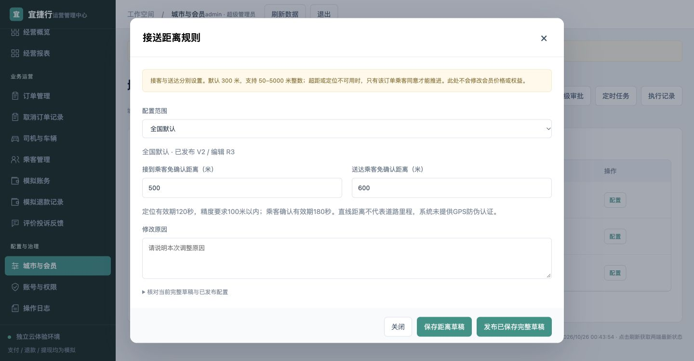
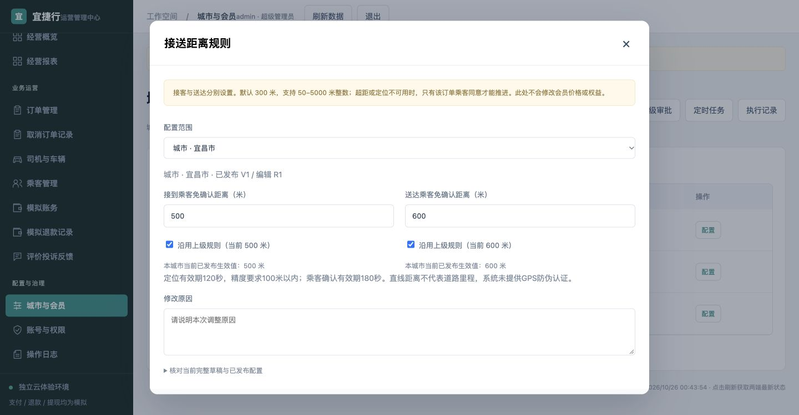
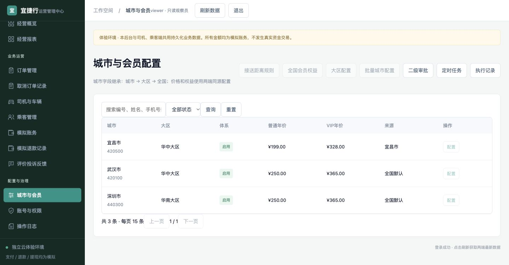

# 接送距离后台 · 非作者浏览器验收

Web固定提交 `c10aadfc98b5cc48de70568e6c3a1a9cc9b423ad`；API `8ec8419d30955c216d7e4fe90451584d2a9622cf`。backend审查root作者Web；仅Chrome、本地8808临时合成数据，未改产品/部署/ADB/原环境，未重复后端208。操作结束QA页1055271350已关闭，Chrome已归还。

结论：配置主流程PASS，有1项P2文案待作者修复；精确1366、大区发布、非空历史未运行，不能称全范围验收。

1. **确认详情：基本健康，有P2。** DISTANCE-UI先看到等待乘客同意，稍后重开为“确认已过期”；未知距离显示“定位不足，未计算”，原阈值300，规则/定位快照可展开。原始过期AX保存在expired-detail-ax.txt。触发原因直接显示DRIVER_LOCATION_MISSING，缺中文解释，已即时报告root并获确认。
2. **默认规则和校验：健康。** 全国300/300；0、50.5、5001分别被min/整数步长/max拦截，没有保存。Chrome原生校验提示是英文，属于本次浏览器语言环境限制。
3. **保存草稿：健康。** 500/600保存后仍published300/300，重新打开有未发布草稿。实际页面完整JSON见draft-vs-published.json，已断言全部levels相同。
4. **完整草稿发布：健康。** 确认框明确发布整份已有草稿及可能包含其他修改，未保存输入不提交。将表单接客临时改700未保存，发布显示/生效仍500/600；输入原因并勾确认后全国V2，会员价未被修改。
5. **城市继承：健康。** 宜昌继承值500/600，两输入禁用；取消接客继承可写550并保存草稿，实际生效仍500。再勾继承保存，实际页面JSON显示draft.tripDistance={}，levels与published相同。未发布城市草稿。
6. **只读角色：健康。** viewer登录，距离规则/会员/大区/城市配置按钮禁用；可以读订单确认详情。城市价格仍宜昌199/328、武汉深圳250/365。
7. **审计：观察通过，截图有限。** 实际UI读到210全国draft、211全国publish、212/213城市draft、209系统过期审计。07截图只拍到审计表头，未把行拍入，不将其当作完整行证据。

截图均为本轮Chrome原图、已从保存文件检查。实际viewport1440×749，未冒称1366。未做完整无障碍审计；控件标签/禁用状态可见，屏幕阅读器与全键盘路径NOT_RUN。fixture无非空确认历史，未人为补造。此fixture展示验证不算独立订单推进测试（root另行执行）。

下一步：root作者修中文原因映射并提供固定新SHA；backend仅限定复看详情。测试留下全国V2=500/600，宜昌恢复继承草稿未发布，均仅临时本地fixture。报告/截图由root统一入库，本角色未提交其他人的协调文件。
